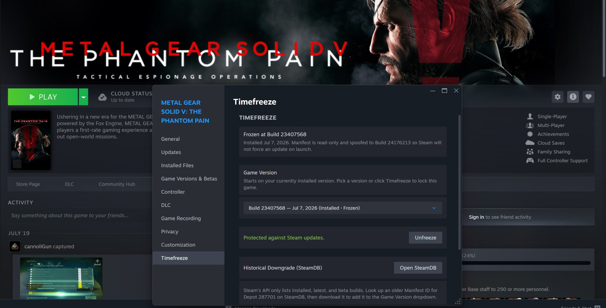

# Timefreeze

A [Millennium](https://steambrew.app) plugin that adds a **Timefreeze** tab to every Steam game's **Properties** dialog, letting you lock a game at its current version so Steam will not update it or force an update on launch.

[](intro.png)

## Features

- **Right in Properties:** No extra settings menu — just a **Timefreeze** tab at the bottom of each Steam game's **Properties** window.
- **One-click freeze:** Opens with your currently installed build selected, ready to freeze immediately.
- **Native Play button:** Spoofs the game's `appmanifest_<appid>.acf` to the latest public build and marks it read-only, so Steam treats the game as up-to-date and launches it normally (Overlay, Cloud Saves, and Achievements stay intact).
- **Stays frozen across updates:** When a game receives a new Steam update later, Timefreeze refreshes the spoofed manifest automatically on Steam startup.
- **Clean unfreeze:** Click **Unfreeze** at any time to restore the original manifest and writable attributes.
- **Branches & historical downgrade:** Switch between public beta branches, or open SteamDB Depots to download an older build through Steam's built-in `download_depot` command.

## Install

Requires [Millennium](https://steambrew.app).

1. Download `steam-timefreeze-<version>.zip` from the [latest release](../../releases).
2. Extract it into `<Steam>/millennium/plugins/`, so the plugin is in `<Steam>/millennium/plugins/steam-timefreeze`.
3. Restart Steam and enable **Timefreeze** in the Millennium settings.

To update, replace that folder with the new release's. Your frozen game records and manifest backups are kept in `<Steam>/millennium/config/steam-timefreeze/`.

<details>
<summary>Build from source instead</summary>

Node.js 20+:

```bash
npm install
npm run build
```

Then copy the folder (with the generated `.millennium` folder inside it) to `<Steam>/millennium/plugins/steam-timefreeze`.

</details>

## Support

If this plugin is useful to you, you can support its development on [Ko-fi](https://ko-fi.com/cannoligun).

## License

MIT
